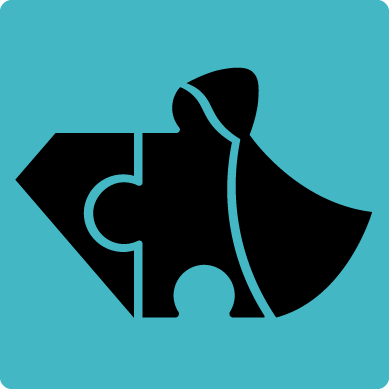

# RunnerRPG

A mobile-oriented RPG project I built with **Unity and C#**. I worked on gameplay features and the user interface, and I created vector-based artwork for the game's UI. I wanted the screens to feel engaging without making menus and game actions hard to understand.

This repository is a personal project and a snapshot of the work I did while learning and experimenting with game development.

## What I worked on

- **Gameplay and interactions:** turn-based battles, skills, character progression, and equipment upgrades.
- **UI development:** character menus, battle information, inventory/equipment screens, progress indicators, and interactive buttons.
- **Visual design:** vector illustrations and interface elements, with a focus on clear navigation and an engaging mobile experience.
- **Game data:** Unity ScriptableObjects for characters, skills, and equipment, plus local save/load logic.
- **Debugging and iteration:** testing gameplay flows and adjusting the code and interface as the project evolved.

## Tech stack

**C# · Unity · Unity UI · ScriptableObjects**

The project records **Unity 2020.3.1f1** in its settings. It also uses third-party packages, including DOTween.

## A look at the project

Some useful places to explore in the code:

- [UI and screen navigation](Assets/CanvasManager.cs)
- [Turn-based battle flow](Assets/Scripts/SCENE%20Battle%20%28Brackeys%29/BattleSystemBR.cs)
- [Character data and attributes](Assets/Scripts/Player/CharacterSO.cs)
- [Equipment upgrade UI](Assets/Scripts/SCENE_Armor/SetArmorUI.cs)
- [Progression and character UI](Assets/Scripts/SCENE_Char%20Menu/LevelUI.cs)
- [Saving and loading game data](Assets/Scripts/LoadSave.cs)

## Opening the project

1. Install **Unity 2020.3.1f1** through Unity Hub.
2. Clone or download this repository.
3. Open the repository folder as a Unity project.
4. Check the scenes in `Assets/Scenes`. The build settings list `CharMenu`, `SkillFarm`, `Battle`, and `Armor`.

**Note:** This is an older project, and I haven't verified it with newer Unity versions. Some package references in `Packages/manifest.json` point to paths on the computer where the project was originally developed, so they may need to be corrected before opening it on another machine. A downloadable mobile build is not included here.

## About the assets

I designed UI elements and vector illustrations for the game. The repository also includes third-party packages and assets used during development; those aren't presented as my original work.

---

**What I enjoyed most:** getting to work on both sides of the experience: how a feature behaves in code, and how someone understands and uses it on screen.
